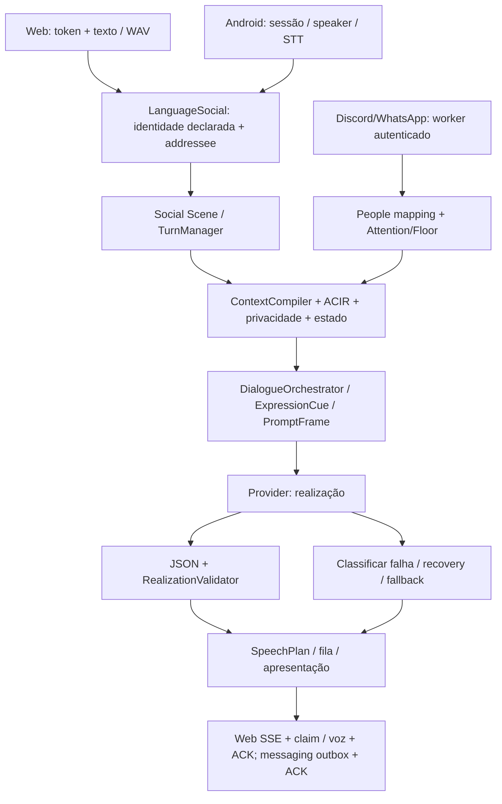

# AMORA — Fase 1: auditoria forense do Core

Data: 2026-11-08 (America/Recife). Somente Fase 1; nenhuma reorganização
ou promoção das Fases 2/3 foi executada.

Base auditada: **7504d23d0203b6821ae498f1d1439424f263a3ac**,
confirmada por `git ls-remote origin refs/heads/main` e `git fetch origin main`.
Branch de entrega: `audit/phase1-core-forensics`.
O checkout restaurado inicialmente estava limpo em `feat/social-persona-abc`,
HEAD `86031bd07f44ad43b2c220d5cd8aab4d1a7ddb01`; não foi tratado como main.

## 1. Diagnóstico do executor e alcance da evidência

O executor anterior falhava antes de executar comandos. Nesta retomada,
`wait_for_environment` retornou `ready`, status `connected`, `pwd` retornou
`/workspace`, e terminal/filesystem/Git/leitura de `AGENTS.md` funcionaram.
Python local: **3.12.14**. Codex: **0.167.0-alpha.4**. Node: **24.22.1**.
Primeiro teste: `tests/test_time_service.py`, **1 passed**.

Lidos AGENTS, canon SKILL/ARCHITECTURE/GDD, roadmap VERSIONS, PROJECT_STATE,
ADRs 0026/0036/0037/0038, implementações e dependências citadas abaixo.
O checkpoint possui texto histórico conflitante: Qwen como baseline/candidato
Mistral e, em outra seção, promoção do Mistral. A decisão vigente ADR-0036 é
compatível com `app.py:220`: default Mistral, registrado somente com chave.
Não usar a data antiga do cabeçalho ou o resumo histórico como configuração real.

Evidência **offline** executada com SQLite temporário e providers simulados,
além de container e navegador reais. Nenhuma geração NVIDIA/OpenRouter/Groq,
nenhum teste em conta Discord real, Android físico ou deploy remoto foi feito.
Não há conclusão sobre qualidade live, quota real, HEAT percebido ou acústica.

## 2. Arquitetura observada e ownership



| Fronteira | Implementação e responsabilidade observada |
|---|---|
| Web | `web/app-v2.js:287`, `:363`; `core/amora/web/routes.py:38`, `:175`, `:253`: token, input, flags e SSE; destino explícito Amora. Não decide identidade/persona. |
| Android/áudio | `core/amora/api.py:318`, `:336`; `audio/speaker.py:6`, `language/pipeline.py:128`: STT e speaker declarado/diarização, inferência de destino; A15 não herda automaticamente override Web. Speaker não autentica. |
| Social | `social/addressee.py:42`, `social/scene.py:48`, `conversation/turn_manager.py:17`: destinatário, floor e se há turno; não realizam conteúdo. Surface privada evita roubar floor ambiente (`language/pipeline.py:78`). |
| Messaging | `messaging/routes.py`, `messaging/service.py:100`, `:187`, `messaging/attention.py`: worker/People resolve ator e atenção; usa sessão derivada da conversa e request cognitivo. **Não atravessa o mesmo observe_completed_utterance Web em todos os caminhos**; há fronteira de apresentação própria. |
| Semântica | `language/acir.py:50` gera envelope conservador, não parser geral de narrativa. `cognition/context.py:110` compõe fatos/privacidade/estado; `dialogue.py:155` decide ato/moves, não ações autorizadas. |
| Expressão | `expression.py:34`, `:122`, `prompt_frame.py:18`, `:87`, `realization.py:211`: projeção de identidade, estado e orientação de realização. Não são donos de fatos ou permissões. |
| Provider | `providers_nvidia.py:211`, `:245`, `:277`; `providers_structured.py:153`; adapters finais em `providers_identity.py`/`providers_openrouter.py`. Só realização; transporte não pode promover texto a verdade. |
| Contrato/estado | `realization.py:61`, `:71`; `self_choice.py:35`: estrutura, atos, perguntas, comprimento e propostas de preferência. Commit local, uma vez, com gate de test_mode; não há verificação geral da verdade de cada frase. |
| Entrega | `conversation/service.py:266`, `:348`, `web/app-v2.js:409`, `:760`; messaging outbox/lease/ACK. Renderizar, enfileirar, exibir e ser ouvido são estados distintos. |

MRO real, consultado no Python:

```text
capability_runtime → resilience_runtime → identity_runtime → structured_runtime
→ production → resilient → hardened → service
ContextCompiler: context_v1 → context
```

O layering preserva overrides históricos, mas torna difícil saber qual
`respond`, `replay`, registro de provider e tratamento de erro está ativo.
Há múltiplas implementações de failover e adaptações/re-registro de Gemini.
Isso é dívida de organização comprovada por estrutura; não é prova de que
cada override está errado. Não foi feito refactor para “simplificar” a MRO.

## 3. Inventário reproduzido

Todos os testes citados estão em `tests/test_phase1_forensics.py`.
**XFAIL estrito não é aprovação**: cada marca representa comportamento
requerido ainda quebrado, com `raises=AssertionError` para não ocultar erros
arbitrários. Com `--runxfail`, as assertions falham de fato; não há mocks que
substituam o próprio classificador/validator em teste.

### F01 — Pergunta indireta de terceiro vira self-fact (P1)

- Esperado: reagir à narrativa, sem responder o nome da Amora.
- Observado: `Lia perguntou a Rui qual seu nome, e ele respondeu Carlos.
  Achei estranho.` produz `answer_self_fact`, `fact_key=canonical_name`.
- Causa: `dialogue.py:199`, `:637` buscam texto, e o filtro de relato
  `:557` só remove aspas com marcadores. Não há atribuição semântica de
  relato indireto; ACIR conservador não resolve esse papel para o plano.
- Prova: `test_indirect_question_does_not_request_amora_name`.
- Proposta Fase 2: representar autoria/alvo/escopo da pergunta antes de
  selecionar self-fact. Risco: perder perguntas coloquiais legítimas se
  corrigido com mais uma blacklist de expressões.

### F02 — Relato de atração alheia autoriza e pode persistir preferência (P1)

- Esperado: discutir Rui/Lia, sem autorizar escolha pessoal da Amora.
- Observado: `Lia perguntou se Rui gosta de mulheres, e ele disse que sim.
  Foi uma conversa entre eles.` libera `self_choice_keys=[physical_attraction]`.
  No Core real com provider simulado e test_mode desligado, uma proposta
  estruturada passa e cria `SelfLayer.PREFERENCES.physical_attraction`.
- Causa: `dialogue.py:570` combina substrings de gosto/corpo sem dono do
  desejo; `realization.py:86` e `self_choice.py:67` confiam na elegibilidade
  concedida pelo plano. O validator não tem como reconstruir a intenção.
- Provas: `test_indirect_attraction_does_not_authorize_self_choice` e
  `test_indirect_report_cannot_commit_amora_preference` (F02b).
- Proposta: gate local de primeira pessoa e evidência do pedido, antes de
  abrir self_choices; commit deve exigir essa evidência. Risco: bloquear
  escolhas autônomas legítimas. Testes usaram banco descartável, nunca produção.

### F03 — Filtro de aspas apaga pergunta legítima dirigida à Amora (P2)

- Esperado: `Amora, eu te perguntei: "qual seu nome?"` manter o pedido.
- Observado: `continue_topic`, `fact_key=None`.
- Causa: `dialogue.py:128`, `:557` detectam um marcador e removem **todas**
  as aspas, sem distinguir quem perguntou a quem.
- Prova: `test_quoted_direct_question_preserves_request`.
- Proposta: atribuição por trecho, não remoção global. Risco: regressão nos
  casos entre terceiros já corrigidos por ADR-0038; conservar esses testes.

### F04 — Budget não é uma pós-condição do contexto (P2)

- Esperado: caber no orçamento ou retornar overflow explícito.
- Observado: com `token_budget=256` e entrada de 2.500 caracteres, retorna
  contexto de 3.023 caracteres, estimativa `755 > 256`, sem erro de overflow.
- Causa: `context.py:234` corta apenas listas enquanto existem; retém
  entrada/self/ACIR/plano sem tratar o excesso irredutível. `context_v1.py:71`
  retira capabilities, mas também não impõe pós-condição final.
- Prova: `test_budget_is_respected_when_irreducible_input_exceeds_it`.
- Limite adicional: a estimativa usa caracteres/4 sobre o contexto, sem
  contabilizar todo o protocolo renderizado. Na sonda sacanagem, lab=506
  vs payload=3.206; Core fresco=985 vs payload=3.728 (budget 3.200).
  São estimativas de caracteres, **não contagem do tokenizer NVIDIA**.
- Proposta: prioridades explícitas e orçamento do envelope final; overflow
  observável. Risco: cortar fatos essenciais ou recusar entradas antes aceitas.

### F05 — Plano retido depois de remover sua evidência de histórico (P2)

- Esperado: plano consistente com o snapshot realmente enviado.
- Observado: `Tu entendeu?` autoriza `allow_reflective_question=True`; após
  trimming de todo o histórico, plano permanece True, mas recalculá-lo no
  snapshot final dá False.
- Causa: `context.py:222` planeja antes de `_fit_budget`, que faz `pop(0)`
  do histórico antes de claims/memórias. O modo reply em context_v1 não
  recompila esse plano após a redução.
- Prova: `test_trimmed_snapshot_has_consistent_plan`.
- Não comprovado: troca de autoria pelo corte. O que se perde são turnos;
  envelopes restantes conservam speaker/addressee. Há ainda limites de
  600 caracteres por mensagem e últimas 12 mensagens (`context.py:170`).
- Proposta: seleção por relevância/pares causais e validação do plano final.
  Risco: mudança de fechamento, continuidade e custo de compilação.

### F06 — Timeout interno NVIDIA recebe rótulo de budget da superfície (P1)

- Esperado: distinguir idle do provider, safety total e timeout do caller.
- Observado: `NvidiaStreamTimeout(waiting_first_event, idle)` no provider
  produtivo termina no journal com `SURFACE_BUDGET_TIMEOUT`.
- Causa: `providers_nvidia.py:135` herda `TimeoutError`; no Python atual,
  `asyncio.TimeoutError` é esse mesmo tipo. O catch em
  `structured_runtime.py:249` vem antes de erro genérico e atribui o timeout
  ao caller mesmo sem um deadline local ter disparado. Perde etapa/tipo e
  evita o caminho normal de backoff para falha real do provider.
- Prova: `test_provider_idle_timeout_is_not_a_surface_budget_timeout`.
- Proposta: erros tipados por fronteira e captura específica antes do catch
  do caller; persistir telemetria sanitizada. Risco: penalizar saúde global
  por timeout curto de uma superfície; preservar distinção já pretendida.

### F07 — SECRET persiste texto literal no raw event log (P1, confidencialidade)

- Esperado: SECRET não sair do armazenamento apropriado de segredos para
  eventos/texto cognitivo. AUTH e SECRET precisam ter gates coerentes.
- Observado: `language_social.observe_text(..., privacy_scope=SECRET)`
  grava o marker fictício em `events.payload_json.text`.
- Causa: `language/pipeline.py:85`, `:115` redigem e desativam persistência
  somente em AUTH. EventBus (`events/bus.py:59`) não redige por escopo.
- Prova: `test_secret_observation_has_no_durable_raw_text`, consulta real
  à tabela SQLite; não usou credencial real.
- Delimitação: não foi demonstrado envio remoto desse marker. Context gate,
  CognitiveStore e fila recusam/redigem AUTH/SECRET em outras fronteiras
  (`cognition/context.py:24`, `cognition/store.py:35`, `conversation/service.py:359`).
- Proposta: redigir antes de publicar, incluindo retorno/subscribers e
  metadados, preservando evento causal sem conteúdo; testar Web/áudio/API.
  Risco: apagar evidência operacional útil ou deixar cópia em outro subscriber.

### F08 — Predicado de pai não reconhece relação canônica (P2)

- Esperado: reconhecer `PERSON_BK father_of ENTITY_AMORA` como pai.
- Observado: relações reais incluem `father_of`; style é intimate_colloquial,
  mas `_speaker_is_parent=False`. O vocativo local resulta em `Oi.`.
- Causa: `realization.py:303` aceita father/parent/pai e substring parent,
  mas não father_of. Outras decisões reconhecem father por substring.
- Prova: `test_canonical_parent_is_recognized`; também observado no Chromium.
- Não significa exigir “papis” em toda fala. O defeito é a discordância
  do predicado com o grafo, não uma nota ruim para a frase curta.
- Proposta: consulta semântica e direcional de relação compartilhada. Risco:
  reconhecer como pai relações em direção oposta ou com terceiros.

### F09 — Replay genérico não suporta o Mistral produtivo registrado (P2)

- Esperado: replay do primary registrado executar o contrato correspondente
  ou declarar capacidade não suportada antes de despachar.
- Observado: `respond()` com Mistral simulado valida, mas replay do mesmo
  snapshot retorna `success=False`; o adapter não fornece `stream()`.
- Causa: `production.py:116` replay chama `provider.stream(context)`, enquanto
  `providers_nvidia.py:211` expõe `realize`. O wrapper delega a interface
  ausente. O laboratório A/B usa `_post_chat`, portanto não detecta o problema.
- Prova: `test_generic_replay_supports_registered_structured_mistral`.
- Proposta: replay baseado em capability/interface estruturada e mesmo
  validator, sem efeitos; preservar replay stream legado. Risco: gravar usage,
  escolhas ou conteúdo no estado real ao reutilizar respond diretamente.

### F10 — Literal do usuário reaparece no protocolo system via ACIR (P2)

- Esperado por ADR-0026: protocolo confiável e conversa literal em canais
  separados, preservando autoria e conteúdo.
- Observado: marker literal compilado entra no `system`, não só em mensagens
  de conversa. `ACIRCompiler.compile_utterance` põe `roles.content=text`
  (`language/acir.py:50`); `context.py:227` também liga ACIR ao plano;
  `prompt_frame.py:151` carrega acir/plano em TurnFrame confiável.
- Prova: `test_compiled_literal_stays_outside_trusted_system_protocol`.
- Causa: envelope conservador de conteúdo foi tratado como metadado confiável
  integral. Duplica texto e enfraquece a separação física declarada.
- **Não foi comprovada prompt injection bem-sucedida**; JSON e avisos de
  autoridade ainda delimitam dados. Risco adversarial exige teste próprio.
- Proposta: manter projeção semântica/autoria, excluir literal de sections
  confiáveis, referenciar o ConversationTurn. Risco: perder grounding ACIR.

## 4. Hipóteses A–I: conclusões e limites

| Item solicitado | Conclusão atual |
|---|---|
| A — V3 versus produção | **Confirmado:** `_payload` produtivo (`providers_nvidia.py:245`) não lê V3. `paired_payloads` (`amora_v2_v3_experiment.py:143`) e `sampling_payloads` (`amora_v3_temperature_experiment.py:172`) inserem overlay explicitamente. Docker copia V3 read-only, mas presença no filesystem não ativa uso. Nenhuma flag encontrada para ligar V3 na rota normal. É uma separação intencional dos experimentos, incompatível com presumir V3 ativa em produção. |
| B — Core versus HEAT | V3 tem HEAT 2 default em resenha adulta (`V3:23`, `:40`), mas aceita autoridade do plano (`:130`). ADR-0038 já removeu o teto fixo light_tease em resenhas reconhecidas. Ainda há gates de cena/play/regex. Mesmo texto sacanagem: lab play=.85 → tease/bold_tease; Core fresco play=.22 → continue_topic/react+advance_topic, cue contextual. Teste de caracterização executado. Isso explica uma divergência estrutural; **não prova qual instrução causou uma fala profissional live**. |
| C — regex/terceiros | F01/F02/F03 reproduzidos. Nomes/speaker reais não são equivalentes à detecção de autoria em texto relatado. |
| D — criatividade/validator | Não foi encontrada blacklist lexical no RealizationValidator. Três falas com gíria/palavrão passaram intactas. Gates são schema/moves/closing/depth/self_choices; conversas espontâneas precisam ter espaço no plano. Validação estrutural não certifica verdade, identidade nem qualidade. |
| E — NVIDIA | Transporte separa idle útil/total; heartbeat não reseta idle, reasoning/conteúdo reseta; há regressões existentes que executaram. F06 mostra perda de classificação na integração, apesar do transporte correto. Nenhum SLA remoto comprovado. |
| F — fallback | `structured_runtime.py:165`, `:368` têm Hm/deu branco; ConversationService passa fallback próprio (`composer.py:75`), normalmente Uhum. Messaging distingue E_PROVIDER/E_TIMEOUT. No Web, metadata enfileirada (`service.py:266`) não inclui fallback_used/reason_codes; UI descarta outcome completed (`app-v2.js:317`). Journal/operador possuem parte da causa, com perda em F06. Melhorar causalidade apresentada exige proposta, não adicionar palavrão ao fallback. |
| G — histórico | F04/F05; autoria restante preservada, continuidade pode perder a evidência. Memórias/claims têm gate de audiência. Trimming não garante protocolo completo dentro de budget. |
| H — sintético versus real | Fixture não atravessa auth/social/context real/SSE/fila/outbox. Além do play artificial, Web inicia test_mode=True e exclui turnos de teste do histórico cognitivo (`context.py:172`). Teste real confirmou evento persistido e recent vazio: modo teste não é read-only global nem certificação de continuidade. |
| I — dependências/runtime | Python verde coexistiu com 2 falhas Node ocultas pelo glob do CI. Container e browser foram testados de fato; isso ainda não comprova Android físico, Safari real ou deploy. |

## 5. Deadlines, retries, cancelamento e recuperação

| Caminho | Limites verificados em código |
|---|---|
| NVIDIA produção | idle útil 55s, total 185s, connect min(10,idle); max_tokens ≥4096; reasoning low. Wrapper Mistral: 0 transport retries, 0 validation retries (`provider_resilience.py:191`). |
| Web legado síncrono | attempt65s / total76s, middleware90s. |
| Web SSE | attempt190s / total225s, middleware270s, heartbeat8s. Completed só depois de resposta/queue; nunca reasoning privado/parcial não validado. |
| Laboratório V2/V3 e sampling | idle100s / total225s por candidato, duas chamadas no máximo, sem retry; 429 interrompe (`amora_experiment_transport.py:17`). Não muda produção. |
| Messaging | attempt12s / total20s / cognition24s (`messaging/service.py:31`, `:257`); não herda o budget do laboratório. |
| Outros providers estruturados | proxy permite recovery bounded/repair único; Retry-After longo devolve controle, circuit/quota registram cooldown. Não extrapolar a política Mistral para todos. |

`resilient.py:65` cria task cognitiva e tarefa de cancel; cancelamento externo
cancela/junta o filho. Web SSE, por contrato explícito (`web/routes.py:253`),
mantém task após desconexão do browser; isso **não é bug por si só**.
Stop vocal e cancelamento cognitivo são diferentes; testes existentes de
fila, mute/stop, barge-in e timeout passaram. Cancelamento físico Safari/Android,
desconexão longa com provider real e comportamento do proxy remoto permanecem
pendentes. Hipótese adicional: tasks desconectadas devem ter limite independente
do contador de conexões HTTP; não foi reproduzido abuso/concurrency nessa fase.

## 6. Matriz de execução e qualidade

| Verificação | Resultado real / limite |
|---|---|
| Teste inicial time service | 1 passou. |
| Dependências existentes | `pip check`: sem dependências quebradas. Python local 3.12.14, pydantic 2.14.0b2; lock usado no Docker. |
| Baseline Python antes de alterações | **928 passed, 8 warnings**, 93.18s. Nenhum xfail preexistente. |
| Node baseline amplo | **130 passed / 2 failed**, total132; expectativas obsoletas em testes Shell. |
| Node após correções de testes | **132 passed, 0 failed**. |
| Avatar | **7 passed, 0 failed**. |
| Build Docker runtime | Passou, imagem `amora-phase1:7504d23`; base Alpine/Python3.12.15 e digest do Dockerfile, TLS verificado, CA via secret de build. |
| Smoke container | Passou: non-root, read-only, sem capabilities, no-new-privileges, readiness, Web/Avatar, auth, pairing, SQLite, restart e SIGTERM. |
| Camada de validação no mesmo runtime | Build passou; **58 passed**, 22.26s, seleção igual ao job cloud-contracts. Não é a suíte inteira dentro do container. |
| Chromium real | Passou: UI distribuída → SSE autenticado → fila → texto `Oi.` visível; 1 POST, sem replay, 0 page errors, HTTP401 sem token e403 browser→operator. Remoto e áudio físico desligados. |
| Diagnósticos novos | **6 passed / 11 xfailed estritos**; `--runxfail`: **11 failed / 6 passed**, falhas esperadas de reprodução, não “sucesso” dos bugs. |
| Suíte completa após instrumentação | Ver atualização de execução no final deste relatório; xfails permanecem defeitos abertos. |
| Codex | Três TOMLs lidos; `--strict-config` e `config/read` verificados, camada project ativa, dois roles e cap2. Sem nova inferência. |
| Android | JDK local21; CI fixa17/SDK36/NDK e signing secret. Compilação APK e execução física **não realizadas**; diretórios usuais de SDK não encontrados. Não instalar chave privada para “fazer verde”. |
| Live/deploy | **Não executados**; acesso à API GitHub negado (403). Não inferir estado dos workflows remotos. |

Avisos Python são de campos `register` sobrepostos em modelos Pydantic,
deprecação FastAPI/TestClient e serialização de fixtures Avatar; não foram
transformados em falha nem removidos artificialmente. O pin beta do Pydantic
é justificado pelo Termux/Android, mas exige matriz 3.11–3.14; só 3.12 foi
executado localmente. O build usa lock, CI Core usa ranges e pip atualizado:
há diferença de reprodutibilidade a acompanhar, sem incompatibilidade atual
comprovada nesta máquina/container.

O smoke de browser falhou inicialmente por duas razões do **harness**:
saudação específica indevida (permitiu descobrir F08) e leitura de SSE via CDP
sem body disponível. O script final observa clone do fetch real, sem mock de
rede, e compara completed com texto apresentado. Não rotular esses dois erros
como falhas de transporte da aplicação.

### Corpus e fronteiras já exercitados

| Cenário | Suíte existente executada no baseline | O que não certifica |
|---|---|---|
| Conversa adulta, palavrão e pergunta citada | `test_core_bold_social_scene.py`, `test_ch3_contextual_persona_privacy.py`, `test_phase1_forensics.py` | Naturalidade ou criatividade de um modelo live. |
| Perguntas diretas, opinião e apoio emocional | `test_v10_dialogue_orchestrator.py`, `test_v10_dialogue_emotion_integration.py` | Emoção percebida em áudio físico. |
| Tarefas técnicas e fronteira especialista | `test_realtime_hybrid_v12.py`, `test_ch3_provider_certification.py` | Execução real de ferramenta apenas porque o texto a descreve. |
| Autoria/sessão e continuidade | `test_messaging_lifecycle_stability.py`, `test_conversation_continuity_v10.py`, `test_messaging_shared_conversation_floor_step3.py`, `test_phase1_forensics.py` | Longa conversa real em duas abas ou grupo Discord externo. |
| Falhas, cancelamento e entrega | `test_ch3_provider_certification.py`, `test_cognition_cancellation_v10.py`, `test_web_mistral_turn_budget.py`, `test_web_social_sse.py`, `tests/web_*.test.mjs` | Barge-in no iPhone/A15 com rede real. |
| Autenticação, conta worker e privacidade | `test_admin_command_routes.py`, `test_security_predeploy.py`, `test_platform_messaging_remote.py`, browser real | Segurança completa de um deploy não inspecionado. |

### Comandos reproduzíveis

Na raiz, com o virtualenv ativo:

```sh
pwd
git status --short
git rev-parse HEAD
git branch --show-current
git ls-remote origin refs/heads/main
python --version
cat AGENTS.md
python -m pip check
python -m pytest tests/test_time_service.py -o addopts='' -q
python -m pytest -o addopts='' -q -rxX
python -m pytest tests/test_phase1_forensics.py -o addopts='' -q -rxX
# Diagnóstico: exit 1 esperado enquanto defeitos estiverem presentes:
python -m pytest tests/test_phase1_forensics.py --runxfail -o addopts='' -q
node --test tests/*.test.mjs
npm --prefix avatar test
AMORA_PYTHON=/workspace/amora-venv/bin/python node tools/probes/phase1-browser-smoke.mjs
python tools/probes/phase1_codex_config.py
```

Docker nesta máquina, preservando CA/TLS:

```sh
env -u DOCKER_HOST -u DOCKER_CONTEXT -u DOCKER_TLS -u DOCKER_TLS_VERIFY -u DOCKER_CERT_PATH docker --host=unix:///var/run/docker.sock info
docker build --secret id=proxy_ca,src=/etc/ssl/certs/ca-certificates.crt -t amora-phase1:7504d23 .
python tools/cloud/smoke-container.py amora-phase1:7504d23
docker build --secret id=proxy_ca,src=/etc/ssl/certs/ca-certificates.crt --build-arg RUNTIME_IMAGE=amora-phase1:7504d23 -f deploy/containers/Dockerfile.validation -t amora-phase1-validation:7504d23 .
docker run --rm --network none --read-only --cap-drop ALL --security-opt no-new-privileges --tmpfs /tmp:rw,nosuid,size=256m amora-phase1-validation:7504d23 python -m pytest -p no:cacheprovider -o addopts='' -q tests/test_cloud_runtime.py tests/test_cloud_web_incident.py tests/test_remote_storage.py tests/test_remote_voice.py tests/test_usage_recovery_stt.py tests/test_platform_messaging_remote.py tests/test_storage.py tests/test_conversation_runtime_v15.py
```

Browser requer Playwright e Chromium instalados, sem áudio/modelo. O script
cria runtime/token sintéticos temporários e os remove, não lê segredos de uma
instância produtiva. Em outro host, ajustar `AMORA_PYTHON`/`CHROMIUM_PATH`.
Os testes de cenários e falhas estão versionados; logs temporários desta
execução ficam em `/tmp/phase1-*.log`, sem serem a única forma de reprodução.

## 7. Priorização e plano incremental proposto (não executado)

| Ordem | Impacto / dependência | Entrega pequena sugerida para decisão na Fase 2 | Risco a cobrir |
|---|---|---|---|
| 1 | F07 confidencialidade | Política única de redigir AUTH/SECRET antes do EventBus | Subscriber, retorno, erro e raw log não manterem cópias. |
| 2 | F02 e F01/F03 autoria/identidade | Representação local de autoria, citação e intenção; gate de self_choices dependente dela | Terceiros, direto/indireto, relato/ordem e escolhas legítimas. |
| 3 | F06 e observabilidade fallback | Taxonomia por fronteira; cause/status/idle/total/validator distintos até operador | Não contaminar health por budget curto de uma superfície. |
| 4 | F04/F05/F10 contexto | Snapshot final único, prioridades e orçamento do protocolo; retirar literal do canal confiável sem perder semântica | Continuidade, audiência, relações, autoria e replay estável. |
| 5 | F08/F09 contratos | Consulta direcional de parentesco; capability explícita para replay estruturado | Não confundir pai/filho nem persistir replay. |
| 6 | Integração V3 | Decisão explícita de perfil expressivo versionado para produção, com hash e testes de startup/container/fallback | Preservar fatos/ações, não copiar calibrations nem mudar primary. |
| 7 | Organização | Extrair fronteiras coesas do layering, uma por PR após testes acima | Sem reescrita de Core, duplicação de estado ou migrations gratuitas. |

Teste de personalidade deve registrar separadamente expressão espontânea,
opinião passageira, brincadeira/ficção, fato persistente e ação autorizada.
Cenários adicionais para o próximo gate: humor adulto entre terceiros montando
móvel; bug de compilar arquivo errado; apoio sem conselho; mudança de assunto
e retorno à piada; disputa multiusuário; limites e privacidade; falha de
provider durante SSE e cancelamento explícito. Uma resposta de palavrão fácil
não substitui naturalidade, coerência e originalidade. Não há base nesta fase
para alterar temperatura, promover provider ou reduzir o validator.

## 8. Agentes, alterações e preservação

Exatamente dois agentes existentes: **amora test** (`/root/amora_test`) e
**core especionar** (`/root/core_especionar`), reutilizados. Nenhum terceiro
ou agente aninhado. Seus executores antigos continuaram indisponíveis, mesmo
com principal pronto; por isso foram revisores por mensagens. As reproduções
e gravações foram executadas pelo principal. Ambos ficaram disponíveis para
retomada, sem alegação de teste próprio.

Persistência **confirmada** em `.codex/config.toml` e exatamente dois TOMLs
em `.codex/agents/`, lidos via TOML e `config/read` do Codex instalado. A camada
estava inicialmente desabilitada por confiança; foi adicionada somente a
confiança local deste projeto, depois `config/read` retornou disabledReason=null
e os dois roles efetivos. Cap2 e instruções proíbem novos/aninhados. `max_depth`
não é mecanismo de profundidade do backend V2; essa limitação está explícita
em `.codex/README.md`. Isso não recuperou as sessões antigas nem comprovou
restauração numa tarefa nova.

Alterações locais inequívocas desta fase: corrigidas duas expectativas
obsoletas dos testes Shell para distinguir JSON inválido de rejeição do
validator; CI Avatar passa a selecionar/executar `tests/*.test.mjs`.
**Não foi alterado Core de produção, persona, provider, sampling, banco de
produção ou os arquivos V2/V3.** Bugs permanecem como diagnósticos abertos,
não apresentados como corrigidos por adicionar xfail.

SHA-256 preservados:

```text
V3 884a77ebce1a9513f35b0ee0b05647bbf9331de6ef667e1e37c451a9cc552a1a
V2 55231c98f26e9063c999c92a141143ebcedeb0f0b804f55316a4fe623d84a164
```

Publicação: branch/commit são verificáveis no Git; abertura de PR e CI remoto
são gates separados. A API GitHub retornou `Forbidden`; conferir atualização
de entrega ao fim. Não houve deploy nem avanço para Fases 2/3.

## 9. Fechamento da execução desta Fase 1

A última execução completa terminou em **934 passed / 10 xfailed / 8 warnings**
(95.11s), antes de adicionar a reprodução F10. A seleção final do arquivo
forense, incluindo F10, terminou em **6 passed / 11 xfailed** (1.85s);
com `--runxfail`, **11 failed / 6 passed** (1.79s, exit1 esperado).
F10 foi portanto executado, mas não atribuído retroativamente à execução
completa anterior. Node132/132 e Avatar7/7 passaram após as mudanças de CI/testes.

`sha256sum -c` confirmou ambos os prompts inalterados. Working tree e diff
foram revisados; nenhum arquivo em `core/`, `web/`, `jailbreak/`, manifest
ou lockfile foi modificado. Novos probes/testes e documentação não promovem
correções de produção nem mudam o significado dos xfails.

A API `https://api.github.com/repos/Sllay/Amora-Chibi` retornou `Forbidden`
nesta retomada. A criação de PR será tentada com a branch publicada; em caso
de nova recusa, o corpo ficará versionado em `docs/audit/PHASE1_PR_BODY.md`.
O acesso Git pelo proxy funciona e não exige extrair ou trocar credenciais.
